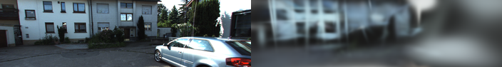
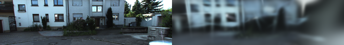
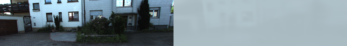

# KITTI-360 first training example

11 training views, 3 held-out views; 1024 Gaussians, 1000 steps.

Mean training PSNR: **17.25 dB**. Mean held-out PSNR: **12.59 dB**.

This is a small baseline diagnostic using supplied camera poses, resized camera-00 images, and the existing random initialization. No SfM point initialization, depth priors, FSGS growth, or side-camera imagery is used. Held-out images are evaluated only after fitting. These are validation results, not a separately reserved final test set.

val/0000000984.png: 15.19 dB

val/0000000992.png: 16.12 dB

val/0000001000.png: 6.46 dB

