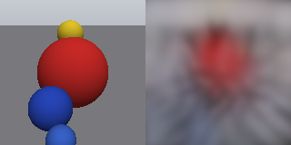
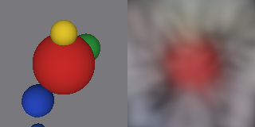

# 3D training results

Mean training-view PSNR: **17.01 dB** over 44 views.

Gaussians: 256; Adam steps: 300; lr: 0.01; seed: 0.

PSNR is the arithmetic mean over per-view float renders. Comparison panels show ground truth on the left and the render on the right.

train/000.png - 15.50 dB

train/022.png - 17.97 dB

train/043.png - 19.56 dB

